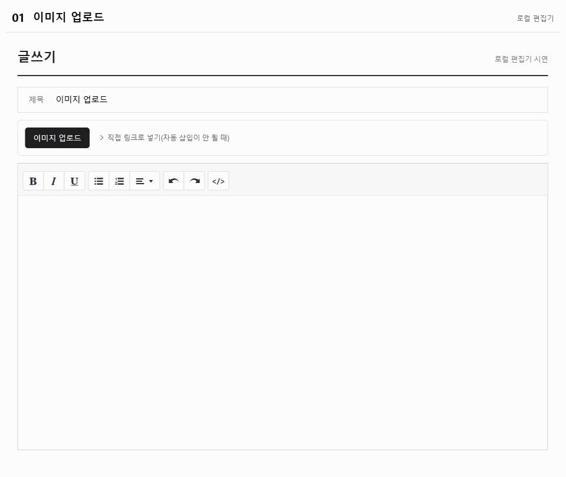

# 디시 이미지 브릿지

디시 PC 글쓰기·수정 화면에서 이미지를 Postimages에 업로드하고 본문에 넣는 Chrome·Edge 확장프로그램입니다.

[다운로드 및 설치](https://ddomology.github.io/dc-postimages-bridge/) · v1.0.4

v1.0.4부터 글 수정 화면에서도 이미지 업로드와 직접 링크 삽입을 사용할 수 있습니다. 기존 사용자는 작성 중인 본문을 보관하고 ZIP을 교체한 뒤 확장 관리 화면과 디시 편집 페이지를 새로고침하세요.

## 설치

1. 사이트에서 ZIP을 내려받아 압축을 풉니다.
2. Chrome은 `chrome://extensions`, Edge는 `edge://extensions`를 엽니다.
3. **개발자 모드**를 켜고 **압축해제된 확장 프로그램을 로드합니다**를 누릅니다.
4. `manifest.json`이 들어 있는 폴더를 선택합니다.
5. 디시 글쓰기 페이지를 새로고침합니다.

설치 폴더는 삭제하지 마세요. 업데이트할 때는 새 ZIP으로 파일을 교체한 뒤 확장 관리 화면과 디시 페이지를 새로고침합니다. 압축해제 설치는 자동 업데이트를 지원하지 않습니다.

## 사용

1. [디시 글쓰기](https://gall.dcinside.com/mgallery/board/write/?id=thesingularity) 또는 본인 게시글의 **수정** 화면을 열고 HTML 모드를 끕니다.
2. 본문에서 이미지가 들어갈 위치를 선택합니다.
3. **이미지 업로드**를 누르고 새 창에서 파일을 선택합니다.
4. 본문을 확인한 뒤 디시에서 등록 또는 수정을 완료합니다.



실제 Postimages 업로드와 로컬 편집기 자동 삽입을 캡처했습니다. 파일 선택 장면은 Windows 탐색기에서 별도로 촬영했습니다. [GIF 저장](https://ddomology.github.io/dc-postimages-bridge/images/upload-demo.gif)

자동 삽입이 안 되면 **직접 링크로 넣기(자동 삽입이 안 될 때)**를 열어 Postimages의 직접 링크 또는 포럼용 핫링크를 붙여 넣고 **본문에 넣기**를 누릅니다. 직접 링크는 `https://i.postimg.cc/`로 시작합니다.

## 동작

- 기본 화면에는 업로드 버튼과 직접 링크 메뉴만 표시합니다. 결과·오류는 동작 후 표시합니다.
- 새 글쓰기의 기본 안내문만 제거합니다. 수정 화면에는 자동 정리를 적용하지 않으며, 기존 본문·링크·이미지는 유지합니다.
- 여러 이미지를 넣을 수 있고, 편집기의 실행 취소를 사용할 수 있습니다.
- 파일은 Postimages에 저장됩니다. 링크를 아는 사람이 이미지를 볼 수 있으며, 본문에서 지워도 업로드 원본은 삭제되지 않습니다.
- 디시의 로그인·인증·최종 등록은 원래 페이지에서 진행합니다. 확장은 쿠키·비밀번호를 수집하지 않습니다.
- PC 글쓰기·수정용이며 모바일 화면은 지원하지 않습니다. 실제 등록·수정 저장 후 외부 이미지 표시 여부는 아직 확인하지 않았습니다.

## 개발

`extension/`이 확장 원본이고 `docs/`가 GitHub Pages 배포 경로입니다.

```sh
node --check extension/content.js
node --test tests/core.test.cjs
```

- [요청 흐름](REQUEST-FLOW.md)
- [검증 기록](VALIDATION.md)
- [화면 캡처 출처](docs/images/SOURCES.md)

버튼은 [Radix의 모노톤 버튼](https://www.radix-ui.com/themes/docs/components/button#high-contrast), 화면 밀도는 [Linear의 UI 정리 원칙](https://linear.app/now/behind-the-latest-design-refresh)을 참고했습니다. 외부 UI 라이브러리 없이 CSS로 구현했습니다.
